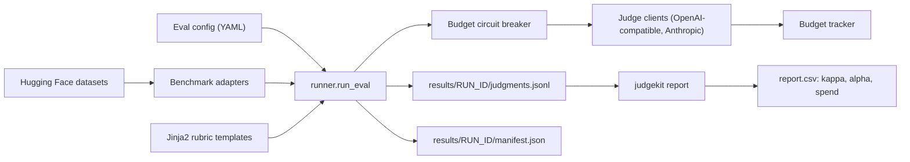

# JudgeKit

JudgeKit is a Python package that sends the same benchmark items to five LLM judges on five API providers, measures how far the judges agree, and keeps the one paid judge under a hard dollar cap.

[](https://github.com/TirtheshJani/JudgeKit/actions/workflows/ci.yml)
[](LICENSE)
[](pyproject.toml)

A single LLM judge carries one model's quirks into every score it gives. JudgeKit asks Groq, Cerebras, SambaNova, OpenRouter and Anthropic judges to label medical and code benchmark items as CORRECT, INCORRECT or UNCERTAIN. It then reports pairwise Cohen's kappa, Fleiss' kappa and Krippendorff's alpha, along with what every call cost.

The judge clients, budget guard, benchmark adapters, agreement statistics, run manifest and report CLI are implemented and unit-tested, with judge API calls and dataset loads mocked. The paid five-judge headline run has not been executed yet, so this repo holds no agreement results. The package is not on PyPI; install from source. Known gaps are listed under [Status and roadmap](#status-and-roadmap).

## Highlights

- One `OpenAICompatClient` covers Groq, Cerebras, SambaNova, OpenRouter and a local vLLM endpoint by switching the base URL. A thin `AnthropicClient` wraps the Anthropic SDK and returns the same `JudgeResponse` (text, prompt and completion tokens, latency).
- Spend control works in three layers. A pre-flight estimate (`judgekit estimate`) prices a config before any call. A thread-safe `BudgetTracker` adds up per-vendor cost from the token usage each API reports. A `BudgetCircuitBreaker` raises `BudgetExceededError` before the HTTP request when the estimated cost of the next call would push total spend past the run's `budget_usd`.
- Cohen's kappa, Fleiss' kappa and Krippendorff's alpha (nominal or interval, tolerant of missing ratings) are implemented from scratch in Python and NumPy. Tests check them against scikit-learn's `cohen_kappa_score`, statsmodels' `fleiss_kappa`, and a reference value computed with the `krippendorff` package.
- `cluster_disagreements` runs KMeans over the judge label vectors of items where the judges disagree and returns each cluster's dominant label pattern with example item ids, so disagreement modes can be read next to the scalar statistics.
- Runs leave an audit trail. Each judgment goes to `judgments.jsonl` (written to a temp file and renamed on close). When a run finishes, a sibling `manifest.json` records the config snapshot, per-vendor and total spend, per-judge error counts and timestamps. A golden-file test pins the report CSV layout.
- 131 test functions across 19 test modules. GitHub Actions runs ruff lint, the ruff format check, mypy in strict mode, and pytest, with no API keys and `JUDGEKIT_ANTHROPIC_BUDGET_USD=0.00`.

## Results

None yet. The headline config ([`configs/all_five_judges.yaml`](configs/all_five_judges.yaml)) has not been run. `results/` is gitignored, the spend table in [`paper/tech_note.tex`](paper/tech_note.tex) still reads TBD, and its pairwise kappa heatmap is a placeholder. The only kappa and alpha values in the repo come from synthetic test fixtures, such as the one behind the report golden test ([`tests/fixtures/golden_report_v1.csv`](tests/fixtures/golden_report_v1.csv)). They describe hand-made labels, not measured judge behavior.

## The five judges

Model ids and token limits come from `configs/all_five_judges.yaml`; prices come from [`src/judgekit/budget/pricing.py`](src/judgekit/budget/pricing.py).

| Judge id (`vendor/model`) | API | Priced at | `max_tokens` |
| --- | --- | --- | --- |
| `groq/llama-3.3-70b-versatile` | OpenAI-compatible | $0 (free tier) | 256 |
| `cerebras/llama-3.3-70b` | OpenAI-compatible | $0 (free tier) | 256 |
| `sambanova/DeepSeek-R1` | OpenAI-compatible | $0 (free tier) | 512 |
| `openrouter/meta-llama/llama-3.3-70b-instruct:free` | OpenAI-compatible | $0 (free tier) | 256 |
| `anthropic/claude-sonnet-4-5` | Anthropic SDK | $3 input / $15 output per 1M tokens | 256 |

Three of the judges serve the same Llama 3.3 70B model through different providers, so one agreement matrix holds both same-model, cross-provider pairs and cross-model pairs (Llama vs DeepSeek R1 vs Claude). The registry also knows a `vllm` vendor at `http://localhost:8000/v1`, with [`scripts/serve_qwen_vllm.sh`](scripts/serve_qwen_vllm.sh) as a launcher for a local Qwen3-8B judge. No config in `configs/` uses it yet.

## Benchmarks

Adapters load each dataset from the Hugging Face Hub with `datasets.load_dataset` at run time; nothing is redistributed.

| Benchmark | HF dataset (split) | Reference shown to the judge | Candidate shown to the judge |
| --- | --- | --- | --- |
| PubMedQA | `pubmed_qa`, `pqa_labeled` (train) | `final_decision` | `long_answer` |
| MedQA-USMLE | `GBaker/MedQA-USMLE-4-options` (test) | `answer_idx` | `answer` text |
| MMLU clinical | `cais/mmlu`: anatomy, clinical_knowledge, college_medicine, professional_medicine (test) | answer letter | not set yet |
| HumanEval | `openai_humaneval` (test) | `canonical_solution` | not set yet |
| MBPP | `mbpp` (test) | `code` | not set yet |

Medical items use `medical_reference_v1.j2` and code items use `code_reference_v1.j2`. The tech-note draft lists the dataset licenses as MIT for PubMedQA, MedQA, MMLU and HumanEval and CC-BY-4.0 for MBPP. `PLAN.md` flags MedQA's license for confirmation.

## How it works



`judgekit run` loads the YAML into pydantic models that reject unknown keys, builds one client per judge, and sends every benchmark item to every judge. Each call goes through four steps:

1. Render the benchmark's rubric template.
2. Ask the circuit breaker whether the estimated cost of the call still fits under `budget_usd`. The estimate takes the prompt's character count divided by 4 as input tokens and the full `max_tokens` as output tokens.
3. Call the judge. OpenAI-compatible requests use `temperature=0` and `top_p=1`.
4. Parse the label from the last line of the reply that is exactly CORRECT, INCORRECT or UNCERTAIN (ignoring case and surrounding whitespace).

Scanning from the bottom lets DeepSeek R1 reason first and answer last. A reply with no such line is recorded as UNPARSABLE. A client exception is recorded as ERROR along with its message, and the run continues. A `BudgetExceededError` stops the run; the JSONL written so far is kept, but no manifest is written.

`judgekit report` builds an items-by-judges label matrix from the JSONL and computes three statistics:

- pairwise Cohen's kappa, over items both judges rated
- Fleiss' kappa, over items every judge rated
- nominal Krippendorff's alpha, with missing cells left out

ERROR and UNPARSABLE share a fourth category code, so failed calls count as their own label rather than as missing data. The CSV adds label counts, per-judge and per-benchmark record counts, and per-vendor spend.

## Cost accounting

The Anthropic judge is the only one with a non-zero price in the pricing table. At 600 input and 150 output tokens, one judgment costs about $0.004.

For the headline config (5 judges, `n: 1100` per benchmark, `budget_usd: 25.0`), the two estimators give different totals:

- `judgekit estimate` assumes 150 output tokens per call and prices the Anthropic judge at about $22.28.
- `scripts/estimate_budget.py` charges a fixed 256 output tokens per call (the Anthropic judge's `max_tokens`) and gets about $31.02, which is above the cap.

Both numbers are fixed-size formulas, not token counts of the rendered prompts. No paid run has been made yet, so there is no actual spend to compare them against. During a run, the cap comes from `budget_usd` in the config. `JUDGEKIT_ANTHROPIC_BUDGET_USD` is only a fallback for a `BudgetTracker` created without an explicit cap.

## Tech stack

| Area | Tools |
| --- | --- |
| Language and packaging | Python 3.11+, uv, hatchling, `src/` layout |
| API clients | httpx, Anthropic Python SDK |
| Config and CLI | pydantic v2, PyYAML, Typer |
| Data and prompts | Hugging Face `datasets`, Jinja2 |
| Statistics | NumPy, scikit-learn (KMeans) |
| Quality | pytest, pytest-httpx, statsmodels (test cross-check), ruff, mypy, pre-commit, GitHub Actions |

## Getting started

Prerequisites: Python 3.11 or newer, [uv](https://github.com/astral-sh/uv), and API keys for whichever judges your config uses.

```bash
git clone https://github.com/TirtheshJani/JudgeKit
cd JudgeKit
uv sync --group dev
```

The `judgekit` name on PyPI belongs to a different project, so `pip install judgekit` will not install this code.

Set the keys the registry reads (the local `vllm` vendor needs none):

```bash
export GROQ_API_KEY=...
export CEREBRAS_API_KEY=...
export SAMBANOVA_API_KEY=...
export OPENROUTER_API_KEY=...
export ANTHROPIC_API_KEY=...
```

Price a config without calling any API:

```bash
uv run judgekit estimate --config configs/all_five_judges.yaml
uv run python scripts/estimate_budget.py --config configs/all_five_judges.yaml
uv run judgekit run --config configs/all_five_judges.yaml --dry-run
```

Run the smoke config (Groq only, 10 PubMedQA items, priced at $0), then build a report:

```bash
uv run judgekit run --config configs/smoke_test.yaml --run-id smoke
uv run judgekit report smoke --out results/smoke/report.csv
```

Agreement statistics need at least two judges. For the five-judge run:

```bash
uv run judgekit run --config configs/all_five_judges.yaml --run-id headline_v01
uv run judgekit report headline_v01 --out results/headline_v01/report.csv
```

`configs/` also has single-domain variants: `pubmedqa_full.yaml`, `medical_full.yaml` and `code_full.yaml`.

Run the checks CI runs:

```bash
uv run ruff check .
uv run ruff format --check .
uv run mypy src/judgekit
uv run pytest
```

Build instructions for the tech note (`latexmk`) are in [`paper/README.md`](paper/README.md).

## Repository layout

```text
JudgeKit/
├── src/judgekit/
│   ├── cli.py          # Typer CLI: run, estimate, report
│   ├── config.py       # pydantic models for eval YAML
│   ├── runner.py       # benchmark x judge x item loop, label parser
│   ├── io.py           # JSONL judgment writer
│   ├── manifest.py     # run manifest writer and validator
│   ├── retry.py        # 429/5xx retry decorator
│   ├── clients/        # Judge ABC, OpenAI-compatible client, Anthropic client, registry
│   ├── budget/         # pricing table, tracker, circuit breaker, estimator
│   ├── benchmarks/     # PubMedQA, MedQA, MMLU clinical, HumanEval, MBPP adapters
│   ├── prompts/        # Jinja2 loader and four v1 rubric templates
│   └── agreement/      # Cohen, Fleiss, Krippendorff, disagreement clustering
├── configs/            # smoke, per-domain and headline eval configs
├── scripts/            # estimate_budget.py, serve_qwen_vllm.sh
├── tests/              # unit tests, mocked API fixtures, golden report CSV
├── paper/              # LaTeX tech-note skeleton and bibliography
├── docs/plans/         # per-phase implementation plans
├── PLAN.md             # phased roadmap and risk register
└── .github/workflows/  # ci.yml, publish.yml
```

## Status and roadmap

The code for Phases 0 to 5 of [`PLAN.md`](PLAN.md) is merged, along with the zero-spend parts of Phase 6 (manifest, report CSV, tech-note skeleton). The live-run gates in those phases (Groq smoke run, four-judge PubMedQA run, Anthropic spend check) have no recorded results in the repo; they wait on API keys and spend authorization. The phase plans live in [`docs/plans/`](docs/plans/).

Known gaps, from reading the code:

- `retry.py` is unit-tested but not yet applied to the client calls. A 429 from an OpenAI-compatible vendor is recorded as an ERROR judgment instead of being retried.
- Only PubMedQA and MedQA supply a candidate answer, and in both cases it is the dataset's own answer text. The MMLU clinical, HumanEval and MBPP prompts render with an empty candidate. Nothing yet generates or imports answers from a model under test.
- The config's `split` and `seed` fields are validated and saved in the manifest, but adapters use their own default splits and nothing reads `seed`.
- `cluster_disagreements` is a library function; the `report` command does not call it yet.
- The report keys its label matrix on `item_id` alone. MedQA ids are row indices and MBPP ids are numeric task ids, so in a run with both benchmarks, items that share an id collapse into one row and the later label overwrites the earlier one.
- `pricing.lookup` returns $0 for any vendor/model pair missing from the table. A new paid model has to be added there before the circuit breaker can see its cost.
- The reference-free templates (`*_reference_free_v1.j2`) exist, but the runner never selects them.

Planned in `PLAN.md`:

- Run the headline config and fill the tech note's agreement numbers, heatmap and spend table.
- Pick a free PyPI distribution name before tagging. `publish.yml` publishes on any `v*` tag.
- Optional: a Streamlit dashboard of judge agreement and a multi-judge backend PR to EleutherAI's `lm-evaluation-harness`.

## References

Agreement statistics: Cohen (1960), Fleiss (1971), Krippendorff (2004). Benchmarks: PubMedQA (Jin et al., 2019), MedQA (Jin et al., 2021), MMLU (Hendrycks et al., 2021), HumanEval (Chen et al., 2021, arXiv:2107.03374), MBPP (Austin et al., 2021, arXiv:2108.07732). Full entries are in [`paper/refs.bib`](paper/refs.bib).

## Author

Tirthesh Jani ([GitHub](https://github.com/TirtheshJani), [LinkedIn](https://www.linkedin.com/in/tirthesh-jani))

## License

MIT. See [`LICENSE`](LICENSE).
